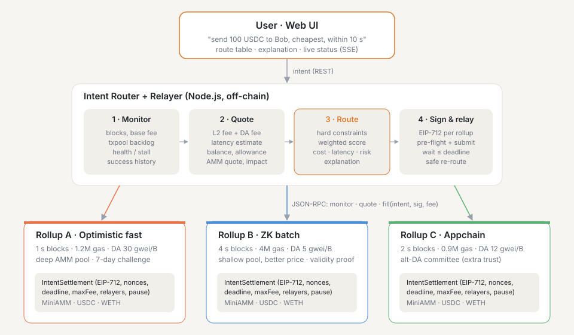

# Cross-Rollup Intent Router (SC6109 · Option 6)

Users say **what** they want ("send 100 USDC to Bob as cheap as possible"). The router decides
**where** it runs. It compares several rollups on fee, latency, congestion, liquidity and
execution-success probability, picks one, explains why, and executes the user-signed intent
there. If a rollup fails mid-flight, it safely re-routes without any risk of double execution.

Everything runs locally: **three real EVM chains** (Anvil) configured as rollups with different
block times, block capacities, sequencer behaviour and DA costs, plus the same Solidity
contracts deployed on each one.



## Feature checklist (Option 6 requirements)

| Requirement | Implementation |
|---|---|
| Intent interface for payment, swap, transfer | EIP-712 `Intent` struct (`kind` = transfer / payment with merchant `ref` / swap); form + natural-language parser in the UI; `POST /api/quote`, `POST /api/intents` |
| Routing layer selecting between ≥ 2 environments | 3 live rollups (A optimistic-fast, B zk-batch-cheap, C appchain with alt-DA); `src/core/router.js` |
| Routing criteria: cost, latency, congestion, success probability | Live EIP-1559 base fee + modelled DA fee; latency from block time + real txpool backlog; congestion %; Bayesian success probability with health detection; swap output / price impact; user max-fee and max-latency constraints |
| Frontend showing route selection and execution status | Rollup monitor cards, route comparison table with score breakdown and plain-English explanation, live execution stepper and log (SSE), history, balances, analytics |
| Analysis of user scalability and system efficiency | Live analytics tab (router vs static choice), offline load simulator (`npm run sim`), live benchmark on real chains (`npm run bench:live`), [docs/DESIGN.md §9](docs/DESIGN.md) |

## Quick start

Requirements: Node ≥ 20, [Foundry](https://book.getfoundry.sh/getting-started/installation) (`forge`, `anvil`).

```bash
npm install
```

```bash
npm run demo
```

`npm run demo` compiles the contracts, starts 3 Anvil rollups on ports 8545–8547, deploys
everything, funds the demo users and serves the UI at **http://localhost:3000**. Press Ctrl+C
to stop. Every start is a fresh, reproducible state.

## Tests

```bash
npm test
```

Latest full run: [results/test-report.md](results/test-report.md).

| Suite | Command | What it covers |
|---|---|---|
| Contracts (23, incl. fuzz) | `npm run test:contracts` | replay, forged/tampered signatures, non-relayer, fee cap, expiry, cancel, insufficient balance, slippage, pool depth, cross-rollup signature isolation, access control, pause, ERC-1271 smart-wallet signer, value conservation, AMM invariant |
| Unit (47) | `npm run test:unit` | routing policies, constraints, explanations, fee model, validation, EIP-712 type string, simulator invariants |
| End-to-end (10) | `npm run test:e2e` | on 3 fresh chains (ports 18545+): digest parity with contract, exact balance changes, exclusions, large-swap routing, merchant ref, no-route failure, 10 concurrent intents, congestion adaptivity, **outage → safe re-route → stale tx reverts on-chain** |

## Results

**Offline load simulation** (`npm run sim` → `results/sim-results.md`). Same routing code,
FIFO sequencers, gas limits, EIP-1559, background traffic, 15 s intent deadline:

| offered load | best single rollup (always A) | round-robin | **router: balanced** |
|---|---|---|---|
| 10 intents/s | 4.9/s confirmed, 50 % fail, $0.19 | 8.3/s, 15 % fail | **9.9/s, 0 % fail, 2.3 s, $0.027** |
| 14 intents/s | 4.7/s, 65 % fail | 10.0/s, 27 % fail | **13.6/s, 0 % fail** |
| 20 intents/s | 4.5/s, 78 % fail | 14.1/s, 30 % fail | **15.5/s, 23 % fail** (all rollups saturated) |

Incident replay (B congested ×4.5, then C halted): users pinned to C lose 78 % of intents,
users pinned to B wait 6.6 s on average. The balanced router stays at 0.2 % failures, 2.2 s,
$0.0195.

**Live benchmark on real chains** (`npm run bench:live` → `results/live-bench.md`). At 20
intents/s for 10 s:

| policy | success | avg end-to-end | avg fee |
|---|---|---|---|
| **router: balanced** | **100 %** | **3.2 s** | **$0.0196** |
| always A (fast) | 100 % | 3.8 s | $0.0702 |
| always B (cheap) | 100 % | 5.8 s | $0.0122 |
| always C | 43 % | 8.3 s | $0.0281 |

## Demo script (≈10 minutes)

Step-by-step recording guide with narration: [docs/DEMO_RECORDING_GUIDE.md](docs/DEMO_RECORDING_GUIDE.md).

1. **Architecture (1 min).** Slide with the diagram. Three rollups with different trade-offs;
   the contracts on each; the router/relayer; the UI. Point out the settlement/DA assumption
   line on each rollup card.
2. **Simple transfer (1.5 min).** Type *"send 100 USDC to Bob as cheap as possible"* → Parse.
   Show the route table: B chosen, the score bars, the explanation ("83 % cheaper, 1.5 s
   slower"), and C excluded for Alice's insufficient balance. Sign & execute, then walk
   through the stepper and log: signed EIP-712 intent → relayer tx → confirmed, estimated vs
   actual latency.
3. **Preference changes the route (1 min).** Same intent with **Fastest** → A. Switch the
   user to Bob, **Cheapest** with *max latency 1.5 s* → C (B excluded: latency).
4. **Merchant payment (0.5 min).** Payment, Bob → Coffee Shop, `ORDER-1001`, fastest.
5. **Swap and liquidity (1.5 min).** Swap 300 USDC → WETH: B has the better price. Swap 3000
   USDC: B and C are excluded for price impact (shallow pools) and A wins. Show "You receive"
   and the impact column.
6. **Congestion (1.5 min).** Click **Congest** on B: pending txs jump, its gas price and
   latency rise, and the same cheapest intent now goes elsewhere. Explain the validity-window
   exclusion. Wait ~30 s and B recovers.
7. **Outage and safe re-routing (1.5 min).** Tick *Simulate a sequencer outage*, execute.
   The chosen rollup halts, its card turns **STALLED**, and the intent times out at the 15 s
   deadline → re-routed → confirmed. Explain why waiting for the deadline prevents double
   execution, then click **Resume** and show (tx status / balances tab) that the stale fill
   reverted.
8. **Analysis (1.5 min).** Live analytics tab (router vs "always X" on the same quotes), then the
   Scalability simulation tab: throughput, failure-rate, fee and incident charts, and the
   trust/centralisation discussion from DESIGN.md §8.

## Project structure

```
contracts/src/       IntentSettlement.sol, MiniAMM.sol, MockERC20.sol
contracts/test/      Foundry tests
config/rollups.js    rollup profiles, demo accounts, balances, router constants
src/core/            pure logic: router.js, feeModel.js, intent.js
src/chain/           rollup.js (monitor, relayer, chaos), devnet.js (anvil + deploy), artifacts.js
src/sim/simulator.js load simulator (same core logic)
src/service.js       intent lifecycle, re-routing, stats
src/server.js        REST + SSE + static UI
public/              frontend (vanilla JS, Chart.js)
scripts/             demo.js, chains.js, sim.js, bench-live.js
test/unit, test/e2e  Node test runner suites
results/             generated benchmark/simulation outputs
docs/                DESIGN.md (architecture, algorithm, trust), DEV_LOG.md (AI usage, bugs),
                     DEMO_RECORDING_GUIDE.md (video steps + narration)
```

## API

| Method | Path | Body / notes |
|---|---|---|
| GET | `/api/rollups` | live metrics, estimates, success probability |
| POST | `/api/quote` | `{user, kind, token, tokenOut?, amount, recipient?, ref?, preference, maxFeeUsd?, maxLatencySec?, slippageBps?}` |
| POST | `/api/intents` | same as quote, plus `forceRollup?`, `simulateOutage?`, `noReroute?`; executes asynchronously |
| GET | `/api/intents`, `/api/intents/:id` | status, timeline, attempts, result |
| GET | `/api/balances`, `/api/stats`, `/api/sim` | balances per rollup, live analytics, simulation results |
| POST | `/api/rollups/:id/congest` \| `halt` \| `resume` | demo chaos controls |
| GET | `/api/events` | Server-Sent Events: `rollups` (1 s), `intent` (on change) |

## Limitations

These are local chains. L1 settlement, proofs and the DA fee are modelled. Funds are not bridged
between rollups. Demo users' keys sign on the backend (a real deployment signs in the wallet).
The relayer is allow-listed. Weights and priors are hand-tuned. See
[docs/DESIGN.md §10](docs/DESIGN.md).
